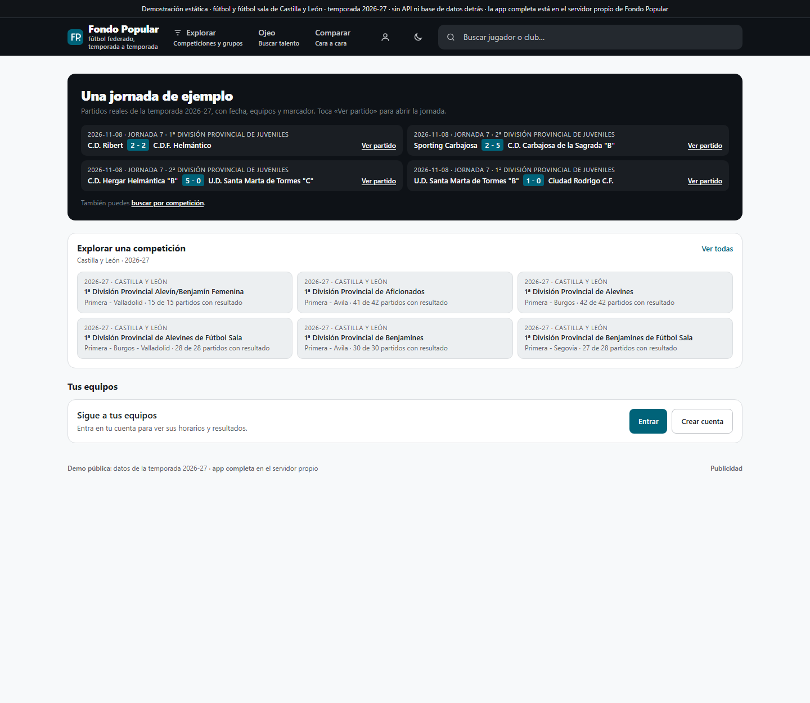
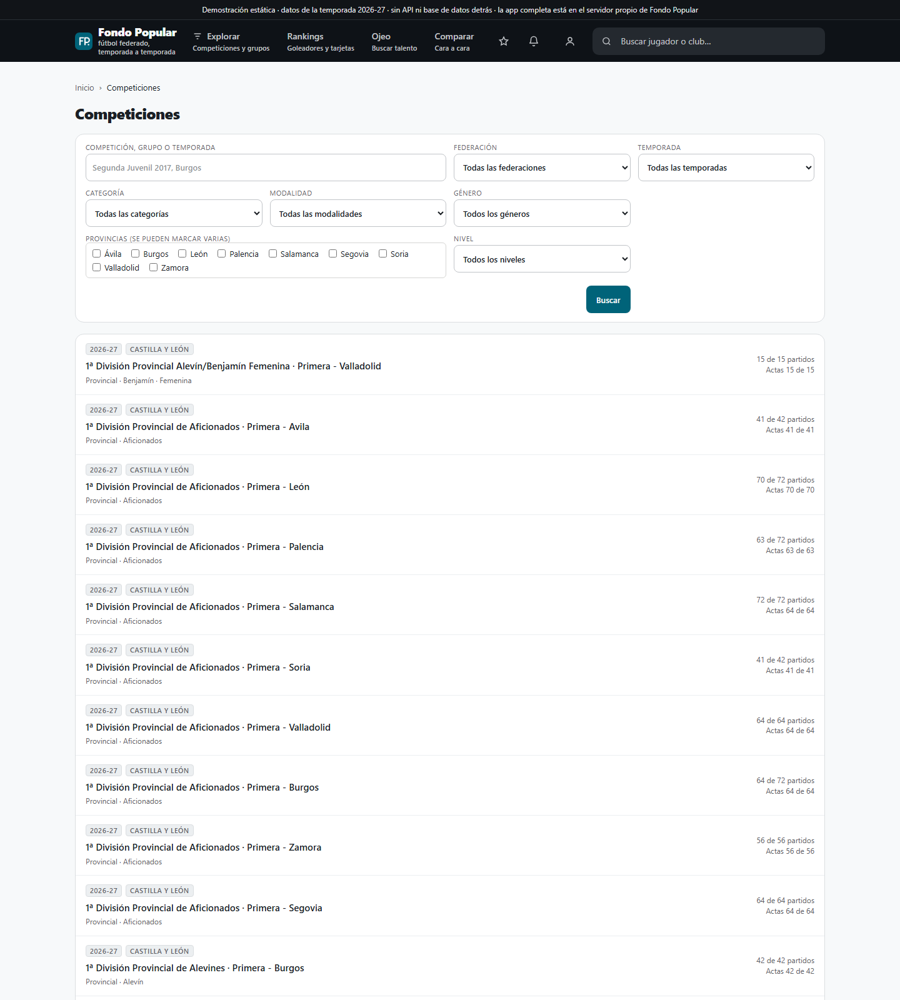
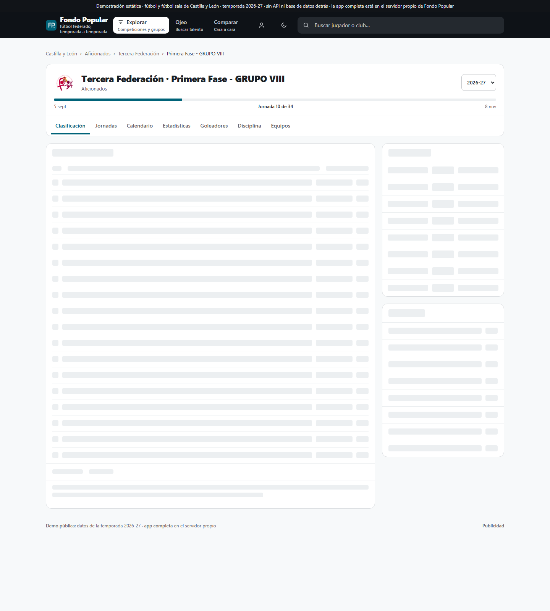
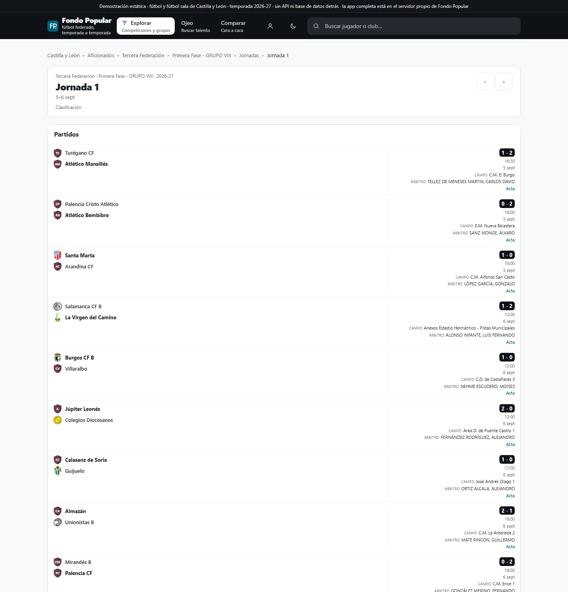
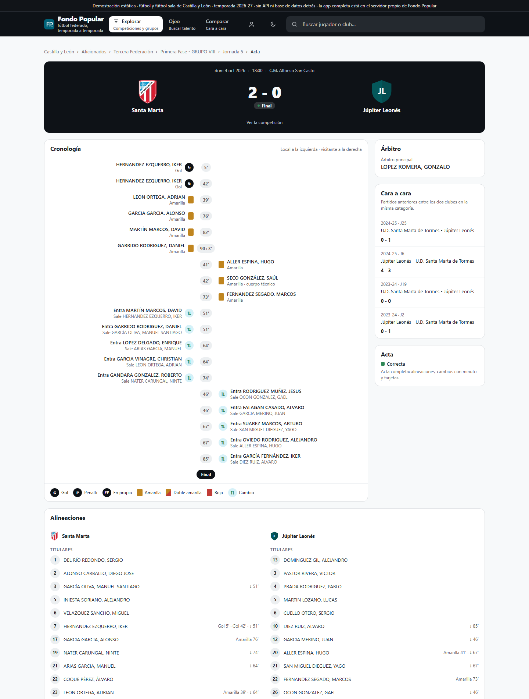

# Fondo Popular — plataforma de datos del fútbol y del fútbol sala de Castilla y León

**Demo pública:** <https://erdeivih.github.io/fondo-popular-demo/> · **Estado:** publicada y en mantenimiento
activo · **Temporada visible en la demo:** 2026-27 (foto estática) · **App completa:** local/servidor propio, todas
las temporadas.

---

## 1. El problema

El fútbol y el fútbol sala de Castilla y León están repartidos en portales de federación con
calendarios, jornadas, clasificaciones y actas en HTML, sin una base consultable: cada temporada se publica en su
propia página, los nombres de clubes y equipos varían entre fuentes, y no hay forma de responder preguntas
sencillas («¿cuántos partidos de la temporada 2014-15 tienen acta?», «¿qué equipos de Soria han jugado en categoría
nacional?») sin abrir decenas de pestañas.

**Fondo Popular** convierte esas fuentes en una base de datos canónica y una web de consulta: 15 temporadas
(2012-13 → 2026-27), 867 competiciones, 3.961 grupos, 328.100 partidos y 312.897 actas, con clasificaciones,
calendarios, resultados, alineaciones, goleadores y trayectorias.

## 2. Qué demuestra (y con qué evidencia)

| Competencia | Cómo se ve en el proyecto |
|---|---|
| **ETL completo** | Recolección con Selenium sobre el portal de la federación → cola SQLite por federación (`trabajos`, `actas`, `peticiones`) → **importador idempotente** a PostgreSQL → proyección y checkpoints de cobertura → publicación. Todo reanudable: un corte de luz no pierde trabajo ni duplica datos. |
| **Modelo de datos** | Esquemas separados `core` (canónico), `analytics` (agregados), `app` (usuarios), `ops` (operación) y `source` (evidencia de ingesta). Entidades distintas para club, equipo-temporada e inscripción; identidades con federación y contexto; marcas de tiempo y procedencia en cada dato. |
| **KPIs y medición** | Una sola definición de «edición completa» (todos sus grupos con checkpoint `completa`) y una tabla por temporada que se publica y se actualiza. Medición de cobertura por grupo, no por intuición. |
| **Calidad y depuración** | Comprobador de codificación que **falla** con doble codificación, U+FFFD o UTF-8 inválido (encontró 22 nombres corruptos fuera del alcance y 0 en CyL); validación de presupuestos de plan por consulta (ms) con instantáneas versionadas; pruebas de contrato contra el canónico real; idempotencia demostrada con recuentos por tabla antes/después. |
| **Automatización** | Pipeline diario con tarea programada (04:30, `StartWhenAvailable`), salida de **una sola línea** en el camino feliz (`CYL COMPLETAS: 206 de 867`) y código de error solo cuando falla. Publicación de la base con dos puertas de cotejo (T1 = T2 y 98/98 tablas). |
| **Producto** | Web Next.js con búsqueda, selector multi-provincia (incluye grupos interprovinciales), clasificaciones, actas, historial de jugador y rankings. Límites de negocio respetados: solo Castilla y León, escudos solo con permiso del club (iniciales por defecto). |

## 3. Números (canónico, 10/11/2026)

| Temporada | Ediciones | Completas | Grupos completos / total |
|---|---:|---:|---:|
| 2012-13 | 3 | 2 | 2/3 |
| 2013-14 | 46 | 5 | 85/231 |
| 2014-15 | 61 | 18 | 249/361 |
| 2015-16 | 65 | 9 | 148/311 |
| 2016-17 | 58 | 6 | 167/286 |
| 2017-18 | 60 | 10 | 143/247 |
| 2018-19 | 61 | 9 | 172/270 |
| 2019-20 | 56 | 1 | 5/224 |
| 2020-21 | 31 | 16 | 309/337 |
| 2021-22 | 66 | 12 | 138/280 |
| 2022-23 | 70 | 32 | 215/286 |
| 2023-24 | 83 | 24 | 169/296 |
| 2024-25 | 79 | 41 | 232/289 |
| 2025-26 | 71 | 20 | 166/301 |
| 2026-27 | 57 | 1 | 1/239 |
| **Total** | **867** | **206 (23,8 %)** | — |

De dónde salen las cifras y qué significan las que faltan está en
[`docs/plataforma-web/CIERRE-CYL-TABLA-FINAL.md`](docs/plataforma-web/CIERRE-CYL-TABLA-FINAL.md): 178 ediciones no
son recuperables con las fuentes actuales (no hay origen publicado) y el resto está en recolección.

## 4. Capturas

**Inicio.** Búsqueda de equipos, jugadores y clubes, con acceso a las competiciones de la temporada.



**Selector de competiciones con filtros.** Temporada, categoría, modalidad, género, nivel y **provincia de
selección múltiple**, con las 9 provincias de Castilla y León y grupos interprovinciales reales
(«Primera - Burgos - Valladolid»).



**Competición y clasificación.** Tercera Federación, Grupo VIII, temporada 2026-27.



**Jornada con resultados.** Marcadores, horarios, campos y árbitros de una jornada real.



**Acta.** Alineaciones, goles, tarjetas, cambios y árbitro de un partido concreto.



> Las capturas son de la demo pública (foto estática de 2026-27). La app completa añade el resto de temporadas,
> cuentas, panel y administración.

## 5. Tecnologías

- **Recolección:** Node.js 24, Selenium + Chrome headless, colas SQLite (una por federación) con reintentos y
  reanudación; pausas respetuosas y límites de memoria/CPU por presupuesto.
- **Datos:** PostgreSQL 18, esquemas `core`/`analytics`/`app`/`ops`/`source`, migraciones versionadas, roles de
  solo lectura y RLS para datos sensibles.
- **ETL:** TypeScript en monorepo pnpm (`packages/canonico`, `packages/ingesta`, `packages/dominio`), importador
  idempotente, proyector de agregados, checkpoints de cobertura.
- **Web:** Next.js 16 (App Router), React 19, TypeScript, Tailwind, consultas SQL con presupuesto de tiempo.
- **Operación:** PowerShell para las tareas programadas del PC, scripts de publicación con cotejo exacto,
  GitHub Pages para la demo y servidor propio (Docker) para la app y la base.
- **Calidad:** pruebas unitarias y de contrato (más de 800 en la web, 164 en los scripts), comprobador de
  codificación, instantáneas de planes de consulta, sin GitHub Actions.

## 6. Cómo se comprueba en dos minutos

```bash
# demo pública: 12 rutas estáticas con datos reales
curl -sI https://erdeivih.github.io/fondo-popular-demo/ | head -1

# pipeline diario: una sola línea de éxito, y exit 0
powershell -File scripts/ciclo-diario-cyl.ps1 -SoloComprobar

# calidad de datos: 0 problemas de codificación en Castilla y León
node scripts/lib/codificacion.mjs --bd --alcance cyl

# cobertura por temporada (tabla de §3)
Get-Content tmp/medir-canonico-cyl.sql -Raw | docker exec -i facylf-postgres psql -U facylf_admin -d facylf -At
```

## 7. Estado y límites (honestos)

- **Publicada:** demo estática en GitHub Pages y app completa en el servidor propio; la base publicada es una copia
  cotejada del canónico (98/98 tablas y 123.601.068 filas idénticas en la última publicación).
- **Cobertura:** 206 de 867 ediciones completas. El resto está en recolección o no tiene origen publicado; la tabla
  por temporada lo detalla.
- **Privacidad:** instancia privada; nombres de menores publicados conforme al consentimiento de tratamiento de la
  federación; fotos de personas, no. Escudos: solo con permiso del club; por defecto, iniciales.
- **Alcance:** esta fase es solo Castilla y León; la arquitectura admite más federaciones, pero la web no las
  muestra.

## 8. Qué haría a continuación

Aumentar la cobertura de las temporadas antiguas (recolección de calendarios y clasificaciones), sustituir la foto
estática por la app completa en un dominio propio, y añadir cuadros de mando de calidad de dato para la operación.
