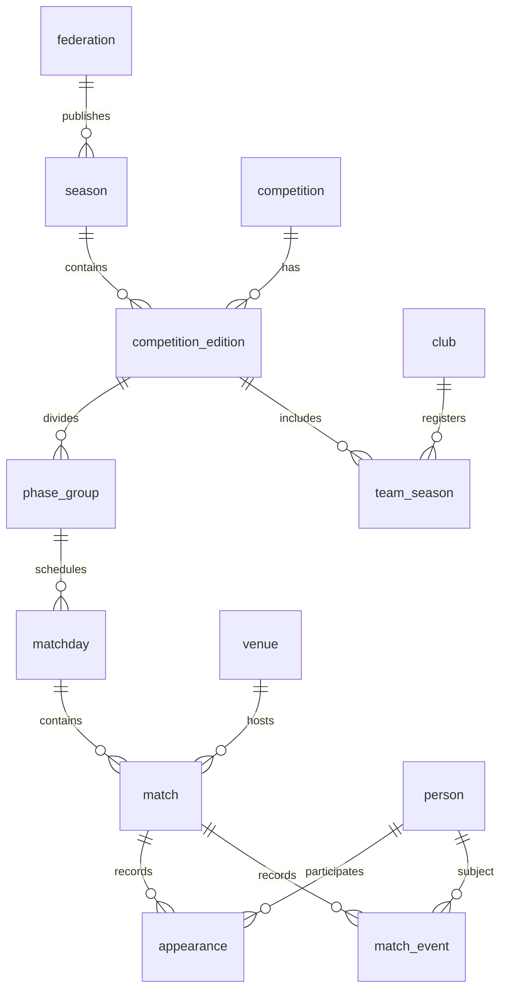

# Modelo canónico, procedencia e identidad

## 1. Principios

1. Un identificador de la fuente sólo es único dentro de `federación + tipo + contexto`.
2. La edición de una competición es distinta de su concepto histórico: “Primera Provincial Juvenil”
   puede existir en 2025-26 y 2026-27 con códigos y grupos diferentes.
3. Club, equipo de una temporada y participante no son la misma entidad.
4. Todo valor derivado conoce su versión de cálculo y los hechos que lo sustentan.
5. Toda fila importada conserva procedencia: fuente, identificador externo, instante, hash y calidad.
6. Desconocido no equivale a cero. No publicado no equivale a “no ocurrió”.

## 2. Esquemas lógicos de PostgreSQL

Se recomiendan cuatro esquemas, aunque inicialmente puedan vivir en la misma base:

- `source`: lotes, registros externos y trazabilidad de SQLite/archivo.
- `core`: entidades y hechos normalizados.
- `analytics`: agregados y series para la web.
- `ops`: versiones de publicación, errores de normalización y auditoría.

La web usa `core` y `analytics` con un rol de sólo lectura. Sólo el publicador escribe en ellos.

## 3. Jerarquía deportiva



### Catálogo

| Tabla | Propósito | Clave natural externa |
|---|---|---|
| `federation` | territorial y adaptador | código interno estable del proyecto |
| `season` | 2015-16, 2026-27 | etiqueta normalizada; el código externo va aparte |
| `competition` | concepto histórico opcional | identidad curada, no código anual |
| `competition_edition` | competición concreta de una temporada | federación + temporada + código externo |
| `phase_group` | grupo, fase regular, ascenso o copa | edición + código externo |
| `matchday` | jornada o ronda | grupo + número/código externo |

`competition_edition` contiene dimensiones de filtro confirmadas o revisables:

- ámbito: nacional, regional, provincial, ascenso, copa, otra;
- modalidad: fútbol 11, fútbol 8, fútbol 7, fútbol sala, playa, desconocida;
- género: masculina, femenina, mixta, desconocido;
- categoría y tramo: aficionados, juvenil, cadete, infantil, alevín, benjamín, prebenjamín;
- provincia/zona;
- nivel ordinal sólo cuando sea comparable dentro de esa federación y temporada;
- estado: prevista, activa, finalizada, cancelada.

No se deducen modalidad o género únicamente por una palabra si el resultado es ambiguo. Se guarda
`classification_confidence` y se permite corrección curada.

### Club y equipo

| Tabla | Significado |
|---|---|
| `club` | organización histórica, con nombre canónico y aliases |
| `team_season` | equipo exacto de club + temporada + categoría |
| `team_entry` | inscripción de ese equipo en una edición/grupo |
| `team_alias` | literal usado por una fuente en un periodo |

“Ribert Juvenil A” y “Ribert Alevín” comparten club, pero nunca plantilla ni estadísticas de equipo.
Un equipo que participa en liga y copa tiene dos `team_entry` enlazadas al mismo `team_season`.

### Partido y acta

`match` conserva marcador oficial, fecha prevista/real, estado y equipo local/visitante. La acta es
evidencia y detalle, no la identidad principal del partido:

- `match_source`: identificadores y URL de cada fuente;
- `match_report`: versión parseada de la ficha, parser y calidad;
- `appearance`: persona, lado, equipo, dorsal y condición;
- `match_event`: gol, tarjeta, entrada, salida u otro evento;
- `match_staff`: técnico, delegado o auxiliar;
- `match_official`: árbitro principal y asistentes;
- `standing_snapshot`: clasificación oficial después de una jornada.

Condiciones válidas de participación:

- `starter`: titular demostrado;
- `substitute`: suplente demostrado;
- `called_up_unknown`: convocado cuya condición no se publica;
- `staff`: nunca se mezcla con una participación de jugador.

`called_up_unknown` suma convocatoria, pero no partido jugado, titularidad ni minutos salvo que un
evento independiente demuestre que participó.

## 4. Identificadores

Las tablas canónicas usan `bigint generated always as identity` o UUIDv7 como clave interna. Las
referencias externas viven en una tabla separada:

```sql
create table source.external_ref (
  id bigint generated always as identity primary key,
  federation_id smallint not null,
  entity_type text not null,
  external_id text not null,
  context_key text not null,
  canonical_id bigint,
  first_seen_at timestamptz not null,
  last_seen_at timestamptz not null,
  unique (federation_id, entity_type, external_id, context_key)
);
```

`context_key` es una representación estable y versionada del ámbito necesario: por ejemplo,
temporada/competición/grupo para un equipo. Nunca se construyen relaciones globales haciendo `JOIN`
sólo por `external_id`.

## 5. Identidad de personas

El código federativo, si existe, produce una identidad fuerte sólo dentro de la federación. Para
relacionar temporadas o fuentes se usa un sistema explícito de candidatos:

| Tabla | Función |
|---|---|
| `person` | persona canónica interna |
| `person_source_identity` | código externo o aparición nominal |
| `person_name` | nombre/apodo literal, normalizado y periodo |
| `identity_candidate` | par candidato, puntuación, señales y estado |
| `identity_decision` | unión/rechazo manual, autor, fecha y motivo |

### Regla de candidatos pedida para el proyecto

El nombre completo normalizado es la puerta de entrada, no la clave primaria. A igualdad de nombre,
las señales se valoran en este orden:

1. misma provincia o continuidad territorial;
2. mismo club en temporadas contiguas;
3. mismo equipo/categoría o promoción temporalmente plausible;
4. código federativo estable, cuando la fuente garantice su ámbito;
5. incompatibilidades: dos partidos simultáneos, equipos incompatibles o homónimos activos.

Una propuesta automática necesita umbral alto y distancia clara frente al segundo candidato. Si hay
dos nombres iguales sin evidencia suficiente, permanecen separados. Las decisiones son reversibles:
no se reescriben las apariciones, se cambia el enlace canónico.

El algoritmo guarda `score`, `features_json`, `model_version` y `decision`. Esto permite recalcular
sin perder la revisión humana. Un apodo nunca se expande a un nombre real no publicado.

## 6. Procedencia y calidad

Cada lote del publicador registra:

- federación y base SQLite origen;
- `source_updated_at` y `ingested_at` por separado;
- ruta/hash del original;
- versión del parser y del normalizador;
- filas insertadas, actualizadas, retiradas y rechazadas;
- cursor incremental y resultado de validación.

Cada `match_report` tiene una calidad:

- `correct`: coherencia suficiente;
- `administrative`: resultado oficial sin desarrollo deportivo normal;
- `review`: contradicción o datos atípicos conservados;
- `partial`: la fuente sólo publica parte del acta;
- `unavailable`: se comprobó que la fuente no la ofrece.

Las incidencias son códigos estructurados con parámetros, no sólo texto libre. Ejemplos:
`LINEUP_COUNT_UNEXPECTED`, `SCORE_EVENTS_MISMATCH`, `MINUTE_MISSING`,
`SOURCE_DOES_NOT_SPLIT_LINEUP`.

## 7. Cobertura y visibilidad

`ops.coverage_checkpoint` contiene, por edición/grupo:

- jornadas esperadas, descubiertas y cerradas;
- partidos esperados/conocidos/con resultado;
- actas enlazadas, disponibles, parseadas, correctas y a revisar;
- `complete_through_matchday`;
- `visibility_state`;
- versión y fecha de cálculo.

La interfaz lee esta tabla; no recalcula completitud recorriendo trabajos en cada petición.

## 8. Estadísticas reproducibles

Toda métrica se define con:

- entidad y grano: jugador-temporada-equipo, equipo-edición, etc.;
- numerador, denominador y partidos elegibles;
- tratamiento de desconocidos y actas administrativas;
- cobertura mínima;
- `metric_version`.

Reglas esenciales:

- el marcador oficial manda para puntos y goles de equipo;
- los eventos individualizados mandan para goleadores, pero una discrepancia se muestra;
- minutos son exactos sólo si titularidad y cambios son fiables; en otro caso son estimados o nulos;
- goles por 90 no se muestra con minutos no fiables o muestra claramente “estimado”;
- no hay asistencias, posición, edad o pie dominante si la fuente no lo publica;
- una propia puerta beneficia al rival, aunque el sujeto pertenezca al equipo que la marcó;
- la clasificación oficial se conserva por jornada; la reconstruida sirve de contraste.

## 9. Agregados propuestos

- `analytics.team_edition_summary`
- `analytics.team_match_form`
- `analytics.team_standing_series`
- `analytics.player_team_season_summary`
- `analytics.player_career_summary`
- `analytics.discipline_summary`
- `analytics.opponent_profile`
- `analytics.search_entity`

Se actualizan sólo para las entidades afectadas por un lote. Cada fila guarda `computed_at`,
`metric_version` y `source_data_version`.

## 10. Migración desde las SQLite actuales

1. Crear una exportación por federación con cursor y hash.
2. Importar catálogo y partidos antes de personas/eventos.
3. Guardar `external_ref` para cada clave compuesta existente.
4. Comparar recuentos por federación/temporada/grupo.
5. Ejecutar validaciones de marcador, eventos, huérfanos y duplicados.
6. Construir agregados sólo después de validar los hechos.
7. Mantener una reconstrucción completa repetible desde cero.

La migración inicial y la incremental deben producir el mismo resultado canónico para el mismo
conjunto de archivos: ésa es la prueba de idempotencia.
